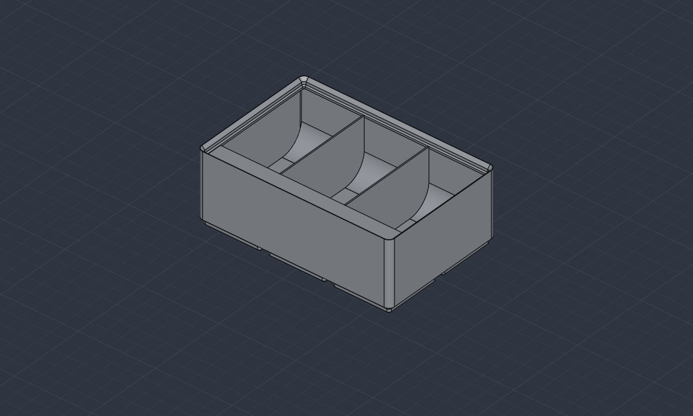
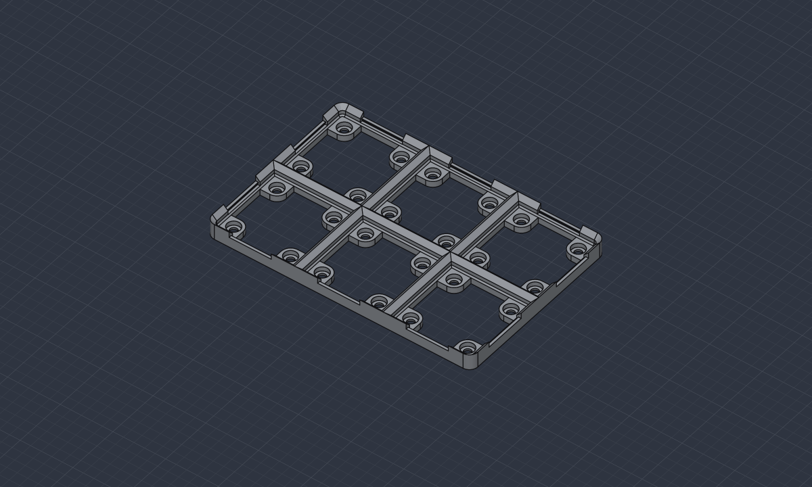
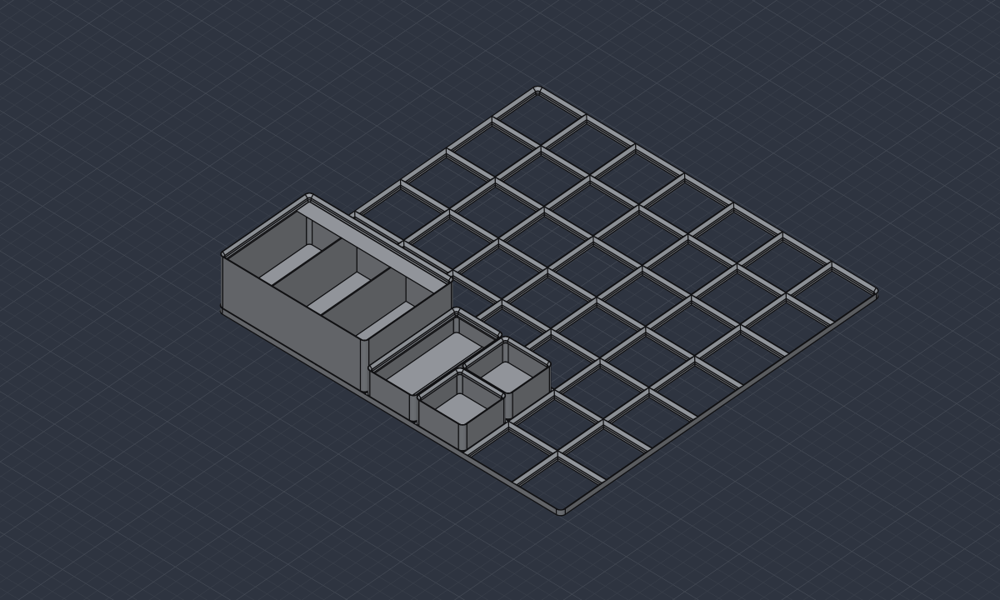

# gridfinity-solidcraft

Parametric [Gridfinity](https://gridfinity.xyz) bins, baseplates, connection clips and drawer
layouts, built as native [SolidCraft](https://github.com/bherbruck/solidcraft) designs.

It makes the same parts as [gridfinitygenerator.com](https://gridfinitygenerator.com/en), with
the same settings and the same dimensions, as Python you can read and extend. Each part is
exported as STL, STEP or 3MF, saved as an editable SolidCraft design, or built live in the
SolidCraft app.



## What it makes

- **Bins**: any grid size and height, with a default, thin or no stacking lip. Magnet and
  screw holes go under the corners or under every cell. Dividing walls, label ledges and
  finger scoops go anywhere on a twelfth-of-a-unit grid, and a bin can be trimmed to fit
  the space left in a drawer.
- **Baseplates**: open-bottomed grids with optional magnet and screw pads, connector slots
  on the edges, and trimming to a drawer's size.
- **Connection clips**: snap two connectable baseplates together.
- **Collections**: several parts laid out on one grid inside a drawer-sized volume, checked
  for overlaps and for fitting, and assembled into one SolidCraft design.

| Baseplate with magnets, screws and connector slots | A drawer collection |
| --- | --- |
|  |  |

## Requirements

- [SolidCraft](https://github.com/bherbruck/solidcraft) 0.10 or later, with `solidcraft-cli`
  on your `PATH`
- Python 3.12 or later and [uv](https://docs.astral.sh/uv/)

## Install

```sh
git clone https://github.com/eric-adam-garner/gridfinity-solidcraft
cd gridfinity-solidcraft
uv sync
```

## Usage

Every part is one command. `--out` picks the format from the file extension and can be
given more than once. Without `--out`, `--script` or `--live`, the part is written as an STL
named the way the web generator names it.

```sh
uv run gridfinity box --units 2 1 --height 3 --out box.stl --out box.step
```

### Bins

```sh
# 3 × 2 bin, 6 units tall, magnets in the corners, two dividers, a scoop and a label ledge
uv run gridfinity box --units 3 2 --height 6 --magnets corner \
    --wall 12,0,24,y --wall 24,0,24,y --scoop 0,0,36 --ledge 0,24,36,flip --out bin.stl

# A thin lip, screw holes under every cell, and a bin trimmed to 70 × 42 mm
uv run gridfinity box --units 2 1 --lip thin --screws full --size 70 42 --out narrow.3mf
```

| Option | Values | Default |
| --- | --- | --- |
| `--units X Y` | grid units, 1–20 each | 2 2 |
| `--height` | units of 7 mm, 2–20 | 3 |
| `--unit-size` | grid pitch in mm, 12–70 | 42 |
| `--lip` | `default`, `thin`, `none` | `default` |
| `--magnets`, `--screws` | `none`, `corner`, `full` | `none` |
| `--magnet-diameter`, `--magnet-height` | mm, 2–8.2 and 1–4 | 6.2, 2.1 |
| `--outer-wall`, `--inner-wall` | mm, 0.4–3 | 1.2, 0.8 |
| `--scoop-shape` | 0.1 (shallow) to 0.4 (nearly a quarter circle) | 0.4 |
| `--size X Y` | trim the bin to this size in mm, from its −X/−Y corner | off |
| `--wall`, `--ledge`, `--scoop` | `X,Y,LENGTH[,y][,flip]`, repeatable | none |

Walls, ledges and scoops run along lines of a grid divided into twelfths of a unit. `X` and
`Y` count twelfths from the bin's −X/−Y corner, and `LENGTH` counts twelfths along the line.
An element runs along X unless `y` is given. A ledge or scoop faces +Y (or +X), and `flip`
turns it round. So `--wall 12,0,24,y` is a full-depth divider one unit in, and
`--ledge 0,24,36,flip` is a label shelf along the back of a 3 × 2 bin.

### Baseplates and clips

```sh
uv run gridfinity baseplate --units 5 4 --magnets full --connectable --out plate.stl
uv run gridfinity baseplate --units 7 5 --size 290 200 --out drawer-plate.stl   # fit a drawer
uv run gridfinity clip --tolerance 0.05 --out clip.stl
```

### Settings files

Any part's settings can be kept as JSON, edited, and built again. Options on the command line
override the file.

```sh
uv run gridfinity box --units 3 2 --height 6 --scoop 0,0,36 --print-config > bin.json
uv run gridfinity box --config bin.json --out bin.stl
```

### Collections

A collection places parts by whole grid cells inside a bounding volume, warns about parts
that overlap or stick out, and saves each part as its own design beside a collection design
that links them. See [`examples/drawer.json`](examples/drawer.json):

```json
{
  "kind": "collection",
  "unit_size": 42,
  "bounds": [300, 300, 60],
  "items": [
    {"name": "plate", "part": {"kind": "baseplate", "grid": {"units_x": 7, "units_y": 7}}},
    {"name": "parts", "x": 3, "y": 0, "rotation": 90,
     "part": {"kind": "box", "grid": {"units_x": 2, "units_y": 1},
              "elements": [{"kind": "scoop", "x": 0, "y": 0, "length": 24}]}}
  ]
}
```

```sh
uv run gridfinity collection --config examples/drawer.json --folder drawer --export stl
```

### Building in the SolidCraft app

`--live` builds the part in the running app, in a new tab, so whatever is already open is
left alone. The app has to be listening on its control port (`solidcraft --control 7878`).
From there the design is ordinary SolidCraft: change it, add features, export it.

```sh
uv run gridfinity box --units 2 1 --scoop 0,0,24 --live --out box.solidcraft
```

## How it works

Each part is a list of SolidCraft commands. The same list runs headless through
`solidcraft-cli` or replays into the app, and `--script` writes it out so the MCP `batch`
tool can run it too.

A part's outer shape is sewn together from flat patches, straight extrusions and ruled
lofts, rather than cut out of a block. That keeps it exact and builds it in seconds even on
large grids. Ordinary booleans run only where faces cross, to add walls, ledges and scoops,
cut connector slots and trim to size.

The tests build parts headless and compare their volume, size and shell count with values
worked out by hand from the dimensions.

## Differences from gridfinitygenerator.com

The dimensions are the web generator's, including its 0.62 mm gap between bins and its
baseplate pockets meeting in sharp corners. The differences:

- **Left out:** cutouts fitted to an imported STL model, GLB export, and the site's accounts,
  saved models and model library.
- **Trimmed bins:** the cut column or row of feet keeps the full foot profile on narrower
  feet, where the site cuts whole feet flat.
- **Construction:** a few details differ so that SolidCraft can build them reliably and
  quickly:
  - the floor of a connector slot sits 0.05 mm lower, below a crease in the pocket wall
    rather than on it;
  - a scoop's curve starts 0.05 mm above the floor rather than just below it;
  - the lip's 0.1 mm apex fillet is four flat facets;
  - walls, ledges and scoops are trimmed at the middle of the outer wall, so none sticks out
    of the bin as the site's can on an edge line or a trimmed bin.

The full list, with the dimensions and the construction rules, is in
[`docs/gridfinity.html`](docs/gridfinity.html); download it and open it in a browser.

## Extending it

| Package | Holds |
| --- | --- |
| `solidcraft_script` | General SolidCraft scripting: command scripts, outlines, surface shells, the headless runner and the app client. It has no Gridfinity in it. |
| `gridfinity` | The parts: dimensions, settings, feet, bins and their elements, baseplates, clips, collections and the command line. |

To add an element kind, give it a cross-section in `gridfinity/elements.py` and a test that
measures what it adds. To add a part kind, give it a settings class, a builder that returns a
command script, and a subcommand. Dimensions shared between parts live in
`gridfinity/standard.py`.

```sh
uv run pytest -q            # build tests need solidcraft-cli on PATH
uv run ruff check src tests docs
```

## Credits

[Gridfinity](https://gridfinity.xyz) is Zack Freedman's modular storage system. The parts and
their dimensions follow [gridfinitygenerator.com](https://gridfinitygenerator.com/en) by
Marcus Svensson; this project is independent of it. Parts are built with
[SolidCraft](https://github.com/bherbruck/solidcraft).

## License

[MIT](LICENSE)
